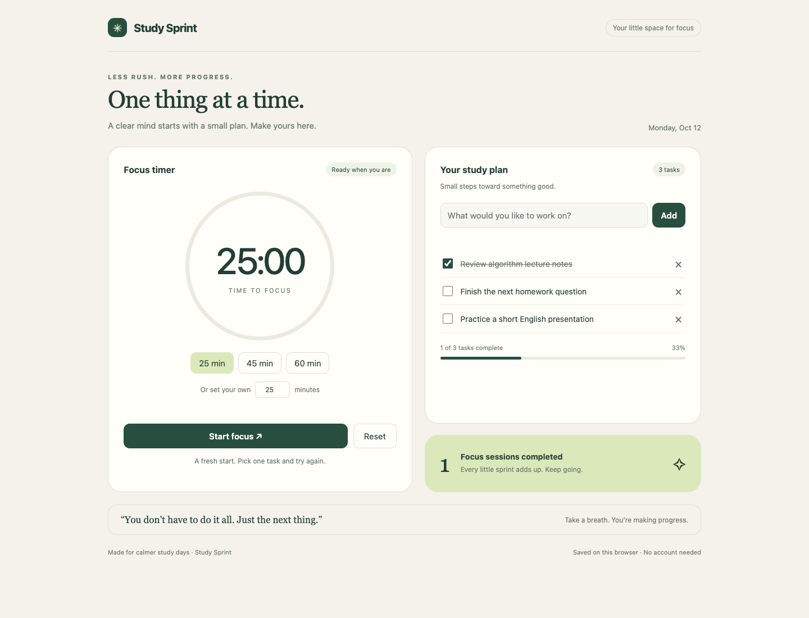
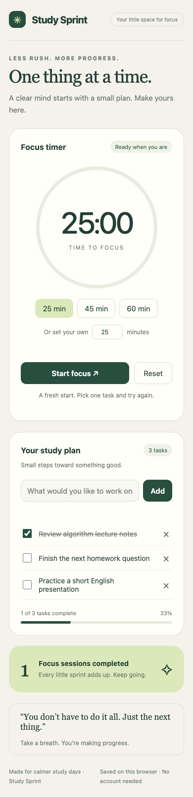

# Study Sprint

A single-file study timer and task tracker built through AI-assisted Vibe Coding.

**Live website:** https://ghiffarr.github.io/study-sprint/

Open `index.html` in a browser, or visit the live website. No installation, build step, external assets, account, or API key is required.

## Specification
- Focus timer: 25/45/60-minute presets and custom whole-number durations from 1–120 minutes.
- Start, pause, resume, and reset controls; circular elapsed-time indicator.
- Completion message and persistent completed-session count.
- Add, complete, and delete tasks; completed fraction and percentage.
- Browser localStorage for tasks and session count. Data is specific to each browser and can be lost when site data is cleared. Timer state is reset when reloading.
- Responsive desktop and mobile layout with labeled controls and keyboard focus indicators.

## AI-assisted development
The initial idea and specification were developed in discussion with AI. AI implemented the self-contained page, including the visual layout and interactive JavaScript. The implementation refined the specification with duration presets, an elapsed-time ring, input validation, safe text rendering, a browser-storage fallback, and a timestamp-based countdown. Desktop and mobile layouts were inspected, and browser tests checked task changes, persistence, input errors, pause/resume, reset, rapid timer clicks, and single-count session completion using an accelerated browser clock.

## Screenshots
Screenshots show sample tasks entered during testing; a new browser starts with an empty task list and zero completed sessions.

